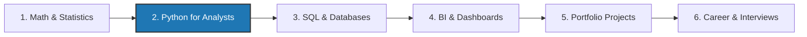

# 🚀 Data Analytics Journey | Complete Learning Path & Portfolio

[](https://www.python.org/)
[](https://jupyter.org/)
[](https://numpy.org/)
[](https://pandas.pydata.org/)
[](https://matplotlib.org/)
[](./python_for_analyst/LICENSE)
[](./python_for_analyst/CONTRIBUTING.md)

Welcome to the **Data Analytics Journey** repository! 🌟

This repository is an open-source, hands-on learning hub and portfolio designed to guide aspiring and practicing data analysts from core programming foundations to advanced exploratory data analysis, business intelligence, and real-world storytelling.

Whether you are self-studying, preparing for technical interviews, or looking for practical cheatsheets and real-world datasets, this project is built for you.

---

## 🧭 The End-to-End Analytics Roadmap



👉 *Explore the detailed career milestone breakdown:* [Complete Career Roadmap](./python_for_analyst/docs/roadmap.md)

---

## 🗂️ Repository Architecture & Learning Modules

```plaintext
data-analytics-journey/
│
├── README.md                                # 📌 Primary Root Landing Guide
│
└── python_for_analyst/                      # 📘 Module 1: Python for Data Analysts
    ├── README.md                            # Module-specific documentation
    ├── requirements.txt                     # Python dependencies
    ├── LICENSE                              # MIT License
    ├── CONTRIBUTING.md                      # Contribution guidelines
    ├── CODE_OF_CONDUCT.md                   # Community conduct standards
    │
    ├── numpy.ipynb                          # 🔢 Numerical computing & vectorization
    ├── pandas.ipynb                         # 🐼 Tabular wrangling & data cleaning
    ├── matplotlib.ipynb                     # 📊 Visualization & subplot dashboards
    │
    ├── docs/                                # 📚 In-depth Conceptual Guides & Cheatsheets
    │   ├── roadmap.md                       # Career roadmap & study path
    │   ├── numpy_guide.md                   # NumPy layout, broadcasting & cheatsheet
    │   ├── pandas_guide.md                  # Pandas indexing, cleaning & cheatsheet
    │   ├── matplotlib_guide.md              # Matplotlib chart framework & handbook
    │   └── datasets_guide.md                # Data dictionaries & 10 guided challenges
    │
    └── data/                                # 📂 Real-World Curated Practice Datasets
        ├── Housing.csv                      # Real estate valuation (545 rows, 13 features)
        └── archive/
            └── Zomato Restaurant Dataset.csv # Global restaurant metrics (9,551 rows, 21 features)
```

---

## 📘 Active Module: Python for Data Analysts

The current core module is located in [`python_for_analyst/`](./python_for_analyst) and contains complete interactive notebooks alongside reading guides:

### 1. [NumPy Fundamentals (`numpy.ipynb`)](./python_for_analyst/numpy.ipynb)
- Memory-efficient array structures (`ndarray`) vs. Python lists.
- Vectorized broadcasting and Universal Functions (`ufuncs`).
- Multi-dimensional slicing, boolean filtering, views vs. copies, and axis aggregations.
- 👉 *Reading Guide:* [NumPy Guide & Cheatsheet](./python_for_analyst/docs/numpy_guide.md)

### 2. [Pandas Data Wrangling & Cleaning (`pandas.ipynb`)](./python_for_analyst/pandas.ipynb)
- Series and DataFrames manipulation, inspection (`head`, `info`, `describe`).
- Label-based (`.loc`) and integer-based (`.iloc`) indexing.
- Multi-condition logical filtering and feature creation.
- Robust data cleaning: finding missing values, null imputation strategies, and deduplication.
- Relational joins (`merge`) and concatenations (`concat`).
- 👉 *Reading Guide:* [Pandas Guide & Cheatsheet](./python_for_analyst/docs/pandas_guide.md)

### 3. [Data Visualization with Matplotlib (`matplotlib.ipynb`)](./python_for_analyst/matplotlib.ipynb)
- Single-variable distributions: Line plots, Histograms, and Box Plots with outlier detection.
- Categorical comparisons: Frequency bar charts and proportional pie charts.
- Multi-category distribution comparisons: Grouped box plots with custom tick labels.
- Aggregated metric visualization with GroupBy (`groupby().sum()`).
- Multivariate analysis: 2 Numerical variables grouped by categorical hue (colors & legends).
- Object-Oriented (OO) API: Multi-panel subplot dashboards (`plt.subplots()`) and tight layout formatting.
- 👉 *Reading Guide:* [Matplotlib Complete Handbook](./python_for_analyst/docs/matplotlib_guide.md)

---

## 📚 Complete Documentation & Guides Directory

You don't need Jupyter running to read and learn! All conceptual documentation and syntax cheatsheets are available directly on GitHub:

| Guide | Description | Highlights | Link |
| :--- | :--- | :--- | :--- |
| **🗺️ Learning Roadmap** | End-to-end curriculum | Stats → Python → SQL → BI → Portfolio Projects | [Read Roadmap](./python_for_analyst/docs/roadmap.md) |
| **🔢 NumPy Guide** | Numerical computing | Contiguous memory, broadcasting rules, ufuncs & syntax table | [Read NumPy Guide](./python_for_analyst/docs/numpy_guide.md) |
| **🐼 Pandas Guide** | Tabular data manipulation | Indexing matrix, missing data imputation, relational joins | [Read Pandas Guide](./python_for_analyst/docs/pandas_guide.md) |
| **📊 Matplotlib Handbook** | Complete visualization handbook | Chart selection framework, grouped box plots, multivariate hue, OO API | [Read Matplotlib Handbook](./python_for_analyst/docs/matplotlib_guide.md) |
| **📂 Datasets & Exercises** | Real-world practice challenges | Schemas for Housing & Zomato datasets + 10 guided business prompts | [Read Datasets Guide](./python_for_analyst/docs/datasets_guide.md) |

---

## 💾 Practice Datasets Included

This repository comes bundled with real-world practice data in [`python_for_analyst/data/`](./python_for_analyst/data):

1. **Housing Dataset (`Housing.csv`)**:
   - **545 records, 13 features** (Sale price, lot area, bedrooms, bathrooms, air conditioning, parking, furnishing status).
   - Ideal for regression modeling, feature correlation, outlier analysis, and price prediction.

2. **Zomato Restaurant Dataset (`Zomato Restaurant Dataset.csv`)**:
   - **9,551 records, 21 features** (Global restaurant listings, aggregate ratings, average cost, cuisines, online delivery flags).
   - Ideal for categorical aggregation, geographical grouping, text parsing, and customer sentiment analysis.

👉 *Check out the full schemas and 10 guided challenges in the [Datasets Guide](./python_for_analyst/docs/datasets_guide.md).*

---

## ⚡ Quickstart: Getting Started Locally

### 1. Clone the Repository
```bash
git clone https://github.com/bonssss/data-analytics-journey.git
cd data-analytics-journey
```

### 2. Set Up a Virtual Environment

**Linux / macOS:**
```bash
python3 -m venv .venv
source .venv/bin/activate
```

**Windows (PowerShell):**
```powershell
python -m venv .venv
.\.venv\Scripts\activate
```

### 3. Install Dependencies
```bash
pip install --upgrade pip
pip install -r python_for_analyst/requirements.txt
```

### 4. Launch Jupyter

**JupyterLab (Recommended):**
```bash
jupyter lab
```

**Or Open in VS Code:**
1. Open the project folder in VS Code (`code .`).
2. Open any notebook under `python_for_analyst/`.
3. Select your `.venv` environment as the Python Kernel in the top-right corner.

---

## 🤝 Contributing

Contributions, issues, and feature requests are welcome! If you have practice exercises, visualization ideas, or corrections, feel free to open a Pull Request.

Please review our [Contributing Guidelines](./python_for_analyst/CONTRIBUTING.md) and [Code of Conduct](./python_for_analyst/CODE_OF_CONDUCT.md).

---

## 📜 License

Distributed under the **MIT License**. See [`LICENSE`](./python_for_analyst/LICENSE) for full details.

---

⭐ **Star this repository** if you find it helpful on your Data Analytics journey!
