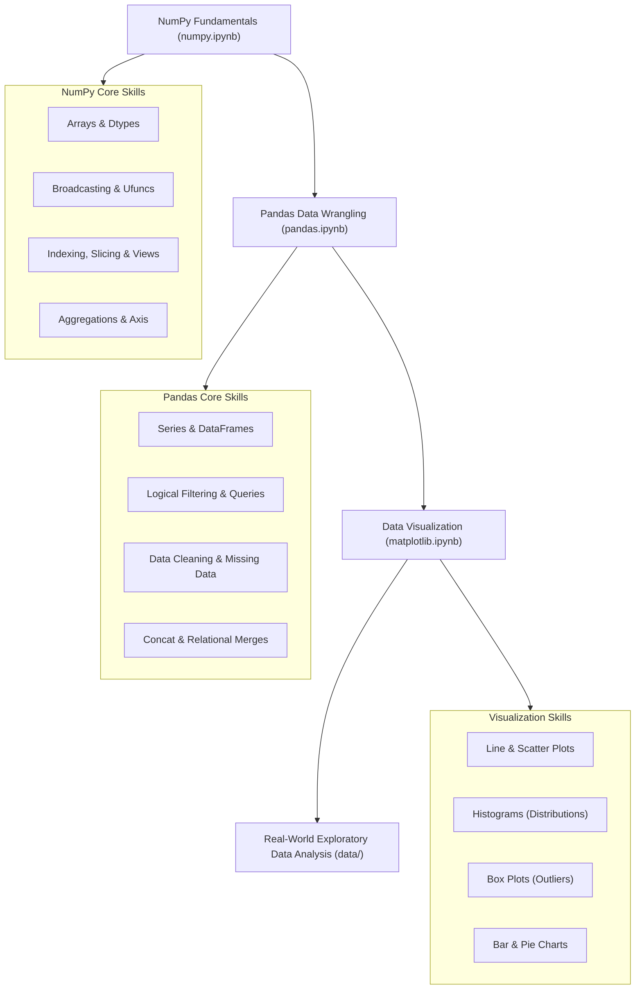

# 📊 Python for Data Analysts | Data Analytics Journey

[](https://www.python.org/)
[](https://jupyter.org/)
[](https://numpy.org/)
[](https://pandas.pydata.org/)
[](https://matplotlib.org/)
[](./CONTRIBUTING.md)
[](./LICENSE)

Welcome to the **Python for Data Analysts** repository—part of the open-source **Data Analytics Journey**! 🚀

This repository is a structured, practical, and hands-on learning hub designed to take you from foundational Python programming to confidently analyzing, cleaning, wrangling, and visualizing real-world datasets. Whether you are self-studying, preparing for technical interviews, or looking for a clean reference guide, this project is built for you.

---

## 🧭 Interactive Learning Roadmap



---

## 🗂️ Repository Structure

```plaintext
python_for_analyst/
│
├── README.md                      # Primary project overview & documentation
├── requirements.txt               # Pinned Python package dependencies
├── LICENSE                        # MIT Open Source License
├── CONTRIBUTING.md                # Contribution guidelines for learners
├── CODE_OF_CONDUCT.md             # Community standards
├── .gitignore                     # Git ignore rules for Python & Jupyter
│
├── numpy.ipynb                    # 📘 Notebook: NumPy numerical computing & vectorization
├── pandas.ipynb                   # 📙 Notebook: Pandas tabular manipulation & data cleaning
├── matplotlib.ipynb               # 📗 Notebook: Matplotlib visualization & outlier detection
│
├── docs/                          # 📚 Comprehensive Reading & Conceptual Guides
│   ├── roadmap.md                 # End-to-end Data Analyst Career Roadmap
│   ├── numpy_guide.md             # NumPy concepts, memory layouts & cheatsheet
│   ├── pandas_guide.md            # Pandas methods, indexing & cleaning cheatsheet
│   ├── matplotlib_guide.md        # Figure anatomy, chart selection & styling handbook
│   └── datasets_guide.md          # Data dictionaries & 10 guided practice challenges
│
└── data/                          # 📂 Datasets for analysis and practice
    ├── Housing.csv                # Real estate dataset (545 rows, 13 features)
    └── archive/
        └── Zomato Restaurant Dataset.csv # Global restaurant dataset (9,551 rows, 21 features)
```

---

## 📓 Interactive Notebooks

### 1. [NumPy Fundamentals (`numpy.ipynb`)](./numpy.ipynb)
Covers numerical computing, contiguous memory structures, and high-performance vectorization:
- **Array Creation**: `np.array()`, `np.zeros()`, `np.ones()`, `np.arange()`, `np.linspace()`, `np.logspace()`, and `np.empty()`.
- **Dimensions & Inspection**: `ndim`, `shape`, `size`, `dtype`, and `itemsize`.
- **Reshaping & Flattening**: `reshape()`, `ravel()` (view), and `flatten()` (copy).
- **Vectorized Arithmetic & Broadcasting**: Fast element-wise arithmetic without slow Python `for` loops.
- **Universal Functions (ufuncs)**: `np.sqrt()`, `np.exp()`, `np.sin()`, and mathematical reductions.
- **Indexing & Slicing**: Multi-dimensional indexing, slicing submatrices, and boolean masking.
- **Memory Safety (Views vs. Copies)**: Inspecting `.base` and avoiding accidental mutation.
- **Aggregations Across Axes**: Sums, means, and standard deviations along `axis=0` and `axis=1`.
- **Custom Vectorization**: Wrapping Python functions with `np.vectorize()`.

👉 *Read the full conceptual companion:* [NumPy Guide & Cheatsheet](./docs/numpy_guide.md)

---

### 2. [Pandas Data Manipulation & Cleaning (`pandas.ipynb`)](./pandas.ipynb)
Covers tabular data manipulation, exploratory querying, and data cleansing:
- **Series & DataFrames**: Creating 1D labeled series and 2D tabular DataFrames.
- **Inspection**: `.head()`, `.tail()`, `.shape`, `.info()`, and `.describe()`.
- **Indexing & Selection**: Integer-location (`.iloc`) vs. label-based (`.loc`) selection.
- **Logical Filtering**: Multi-condition querying with bitwise operators (`&`, `|`, `~`).
- **Feature Engineering**: Creating calculated columns and dropping unwanted features (`.drop()`).
- **Data Cleaning**:
  - Detecting missing values (`isnull()`, `isna()`).
  - Imputation strategies (`fillna()` with mean/median, forward fill, backward fill).
  - Removing incomplete records (`dropna()`).
- **Combining Datasets**: Concatenation (`pd.concat`) and relational database joins (`pd.merge`).
- **Real-World Data Ingestion**: Loading and parsing `Housing.csv` and `Zomato Restaurant Dataset.csv`.

👉 *Read the full conceptual companion:* [Pandas Guide & Cheatsheet](./docs/pandas_guide.md)

---

### 3. [Data Visualization with Matplotlib (`matplotlib.ipynb`)](./matplotlib.ipynb)
Covers exploratory visual analysis and storytelling:
- **Line Plots**: Customizing line colors, markers (`*`, `o`), line styles, and grids.
- **Frequency Distributions (Histograms)**: Binning continuous data to reveal skewness and spread.
- **Outlier Detection (Box Plots)**: Visualizing 5-number summaries (Min, Q1, Median, Q3, Max) and isolating extreme anomalies.
- **Categorical Data Visualization**:
  - Value counts aggregation (`value_counts()`).
  - Bar charts (`plt.bar`) for direct magnitude comparison.
  - Pie charts (`plt.pie`) with percentage labels (`autopct`).
- **Bivariate Relationships (Scatter Plots)**: Examining correlations (e.g. `Age` vs. `Salary`) and sorting values before trendline rendering.

👉 *Read the full conceptual companion:* [Matplotlib Handbook & Chart Matrix](./docs/matplotlib_guide.md)

---

## 📚 Complete Reading Documentation

You don't need a Jupyter server running to learn! You can read our detailed markdown guides directly on GitHub:

| Document | Topic | Description |
| :--- | :--- | :--- |
| [**Career Roadmap**](./docs/roadmap.md) | Career Guide | Step-by-step path: Stats → Python → SQL → BI → Portfolio Projects |
| [**NumPy Guide**](./docs/numpy_guide.md) | Numerical Computing | Array memory layout, broadcasting rules, indexing & syntax cheatsheet |
| [**Pandas Guide**](./docs/pandas_guide.md) | Data Wrangling | DataFrame operations, `loc` vs `iloc`, cleaning nulls & join strategies |
| [**Matplotlib Guide**](./docs/matplotlib_guide.md) | Visualization | Anatomy of a figure, chart selection matrix, outlier analysis & styling |
| [**Datasets & Exercises**](./docs/datasets_guide.md) | Hands-On Practice | Data dictionaries for Housing & Zomato + 10 guided business challenges |

---

## 💾 Datasets Included

This repository contains two curated datasets located in the [`data/`](./data) directory:

1. **[`data/Housing.csv`](./data/Housing.csv)**
   - **Size**: 545 records, 13 features.
   - **Target Variable**: `price` (Home sale price).
   - **Key Features**: `area`, `bedrooms`, `bathrooms`, `stories`, `airconditioning`, `parking`, `prefarea`, `furnishingstatus`.
   - **Ideal For**: Practicing correlation analysis, feature encoding, outlier detection, and regression modeling.

2. **[`data/archive/Zomato Restaurant Dataset.csv`](./data/archive/Zomato%20Restaurant%20Dataset.csv)**
   - **Size**: 9,551 records, 21 features.
   - **Target Variables**: `Aggregate rating`, `Average Cost for two`.
   - **Key Features**: `City`, `Cuisines`, `Has Table booking`, `Has Online delivery`, `Price range`, `Votes`.
   - **Ideal For**: Practicing text parsing (cuisines), geographical grouping, categorical aggregation, and customer preference analysis.

👉 *Check out the schemas and 10 guided challenges in the [Datasets Guide](./docs/datasets_guide.md).*

---

## 🚀 Getting Started

Follow these steps to set up the repository on your local machine:

### 1. Clone the Repository
```bash
git clone https://github.com/bonssss/data-analytics-journey.git
cd data-analytics-journey/python_for_analyst
```

### 2. Create and Activate a Virtual Environment

**On Linux / macOS:**
```bash
python3 -m venv .venv
source .venv/bin/activate
```

**On Windows:**
```powershell
python -m venv .venv
.venv\Scripts\activate
```

### 3. Install Dependencies
```bash
pip install --upgrade pip
pip install -r requirements.txt
```

### 4. Launch Jupyter

**Launch JupyterLab (Recommended):**
```bash
jupyter lab
```

**Or launch classic Jupyter Notebook:**
```bash
jupyter notebook
```

**Using VS Code:**
1. Open the folder in VS Code (`code .`).
2. Open any `.ipynb` file.
3. Select your `.venv` virtual environment as the Python Kernel in the top-right corner.

---

## 💡 Best Practices for Data Analysts

1. **Vectorize First, Loop Last**: Avoid `for` loops when computing over arrays or DataFrame columns; vectorized functions execute in optimized C code.
2. **Watch Out for Views vs. Copies**: Slicing an array or DataFrame may create a view that mutates the original data. Use `.copy()` when you need an independent clone.
3. **Always Check Missing Values First**: Run `df.isnull().sum()` immediately after reading any new data file before calculating statistics.
4. **Choose the Right Chart**:
   - Continuous distributions → **Histogram** or **KDE**
   - Outliers & 5-number summaries → **Box Plot**
   - Discrete category counts → **Bar Chart**
   - Continuous correlation → **Scatter Plot**
   - Trends over time → **Line Plot**
5. **Keep Code Portable**: Never hardcode absolute user paths (like `C:/Users/name/...` or `/home/user/...`). Always use relative paths (`data/Housing.csv`) so others can run your code without modification.

---

## 🤝 Contributing

Contributions make the open-source community an amazing place to learn, inspire, and create! Any contributions you make are **greatly appreciated**.

- 🐛 **Found a bug or broken path?** Open an [Issue](https://github.com/bonssss/data-analytics-journey/issues).
- 💡 **Have a practice problem or notebook improvement?** Fork the repo and submit a Pull Request.
- ⭐ **Found this useful?** Star this repository to support the project and help other learners discover it!

Please review our [Contributing Guidelines](./CONTRIBUTING.md) and [Code of Conduct](./CODE_OF_CONDUCT.md).

---

## 📜 License

Distributed under the **MIT License**. See [`LICENSE`](./LICENSE) for full details.

---

<p align="center">
  Happy Learning & Analyzing! 📈<br>
  <i>Built with ❤️ for aspiring data analysts worldwide.</i>
</p>
