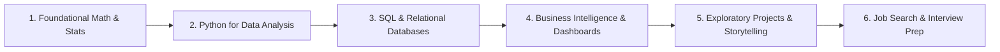

# 🗺️ Complete Data Analyst Learning Roadmap

Welcome to the **Data Analytics Learning Roadmap**! Whether you are completely new to data or transitioning from another career, this guide outlines the end-to-end journey to becoming a job-ready data analyst.

---

## 📌 Roadmap Overview

---

## Stage 1: Math & Statistics Foundation

Data analysis is fundamentally about drawing valid inferences from numbers. You don't need a PhD in pure math, but you do need intuition for:

- **Descriptive Statistics**:
  - Measures of Central Tendency: Mean, Median, Mode
  - Measures of Spread: Variance, Standard Deviation, Interquartile Range (IQR)
  - Skewness and Kurtosis
- **Probability & Distributions**:
  - Normal (Gaussian) distribution and the 68-95-99.7 Empirical Rule
  - Binomial and Poisson distributions
- **Inferential Statistics**:
  - Hypothesis Testing ($p$-values, significance levels $\alpha$)
  - A/B Testing concepts (control vs. treatment)
  - Correlation vs. Causation (Pearson & Spearman coefficients)

---

## Stage 2: Python for Data Analysis (This Repository! 🎯)

Python is the most versatile programming language for data analysts due to its readable syntax and unmatched ecosystem.

### Core Milestones:
1. **Python Core Basics**: Variables, lists, dicts, control flow (`if/elif/else`, loops), functions, and list comprehensions.
2. **NumPy ([`numpy.ipynb`](../numpy.ipynb) | [Guide](./numpy_guide.md))**:
   - High-performance $N$-dimensional arrays (`ndarray`)
   - Vectorized operations and broadcasting (eliminating slow `for` loops)
   - Boolean masking, slicing, and aggregations across axes
3. **Pandas ([`pandas.ipynb`](../pandas.ipynb) | [Guide](./pandas_guide.md))**:
   - `Series` and `DataFrame` data structures
   - Reading, parsing, and writing CSV/Excel files
   - Filtering, indexing (`loc` vs `iloc`), and column transformations
   - Data Cleaning: Handling nulls (`isnull`, `dropna`, `fillna`), duplicates, and type casting
   - Grouping & Aggregating (`groupby`, `pivot_table`)
   - Merging and combining datasets (`pd.concat`, `pd.merge`)
4. **Data Visualization ([`matplotlib.ipynb`](../matplotlib.ipynb) | [Guide](./matplotlib_guide.md))**:
   - Plot types: Line plots, Histograms, Box plots, Scatter plots, Bar/Pie charts
   - Customizing charts: titles, axis labels, legends, grids, and figure sizing
   - Outlier detection and distribution analysis

---

## Stage 3: SQL & Relational Databases

SQL is tested in virtually every data analyst technical interview. Data in companies lives in databases like PostgreSQL, MySQL, Snowflake, BigQuery, and SQL Server.

### Core Milestones:
- **Basic Queries**: `SELECT`, `FROM`, `WHERE`, `ORDER BY`, `LIMIT`
- **Filtering & Pattern Matching**: `LIKE`, `IN`, `BETWEEN`, `IS NULL`
- **Aggregations**: `COUNT`, `SUM`, `AVG`, `MIN`, `MAX`, with `GROUP BY` and `HAVING`
- **Joins**: `INNER JOIN`, `LEFT JOIN`, `RIGHT JOIN`, `FULL OUTER JOIN`, `CROSS JOIN`
- **Intermediate / Advanced SQL**:
  - Subqueries & Common Table Expressions (`WITH cte AS (...)`)
  - Window Functions: `ROW_NUMBER()`, `RANK()`, `DENSE_RANK()`, `LEAD()`, `LAG()`, running totals with `SUM(...) OVER(...)`
  - String manipulation and Date/Time functions

---

## Stage 4: Business Intelligence (BI) & Dashboarding

Stakeholders and executives often consume data through interactive dashboards rather than raw code.

### Core Milestones:
- Master one primary BI tool:
  - **Power BI** (DAX formulas, Power Query ETL, relationship modeling) OR
  - **Tableau** (Calculated fields, LOD expressions, interactive filters)
- **Data Modeling**: Star schema vs. Snowflake schema, fact tables vs. dimension tables.
- **Dashboard UX Principles**:
  - Visual hierarchy (KPI cards at the top, trends in the middle, granular tables at the bottom)
  - Color palette restraint (avoiding "rainbow" dashboards)
  - Actionable insights over vanity metrics

---

## Stage 5: Portfolio Projects & Business Communication

Having a GitHub portfolio with 3 to 4 well-documented projects sets you apart from 95% of candidates.

### Anatomy of a Great Portfolio Project:
1. **Clear Business Problem**: What decision does this analysis inform? (e.g., "Reducing Customer Churn in Telecom", "Analyzing Airbnb Pricing Drivers").
2. **Transparent Data Pipeline**: Documented data extraction, cleaning steps, and assumptions.
3. **Exploratory Data Analysis (EDA)**: Beautiful charts that reveal non-obvious patterns.
4. **Actionable Recommendations**: Clear takeaways for a business manager, not just code snippets.
5. **Interactive Component**: Hosted dashboard (Tableau Public / Power BI web / Streamlit app).

---

## Stage 6: Interview Preparation

- **Technical Tests**: Practice SQL challenges on LeetCode / StrataScratch / HackerRank.
- **Take-Home Datasets**: Practice cleaning messy datasets and presenting findings in slide decks.
- **Behavioral Questions**: Prepare STAR-format stories (Situation, Task, Action, Result) explaining how you used data to solve real dilemmas.

---

[⬅️ Back to README](../README.md)
